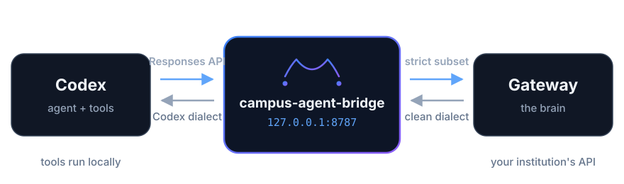
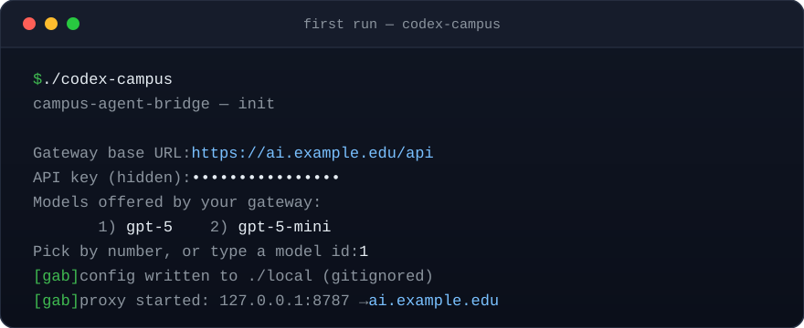

<div align="center">

<picture>
  <source media="(prefers-color-scheme: dark)" srcset=".github/assets/banner-dark.svg">
  <source media="(prefers-color-scheme: light)" srcset=".github/assets/banner-light.svg">
  
</picture>

### Give any chat-only AI gateway real **agent** powers

**Zero gateway changes · Zero cloud relay · Zero npm dependencies**

[](LICENSE) [](https://nodejs.org) [](package.json) [](test/run.js)

**English** · [简体中文](README.zh-CN.md)

[Why](#why) · [How it works](#how-it-works) · [Features](#features) · [Quick start](#quick-start) · [Pitfalls](#the-three-pitfalls) · [Privacy](#privacy)

</div>

---

## Why

Your school or company hands you an OpenAI-compatible **chat** API — great for
asking questions, useless as a coding agent. [Codex](https://github.com/openai/codex)
can plan, run commands and edit files, but only if the endpoint accepts its full
**Responses** dialect. Codex keeps sending things the gateway has never heard
of — and the gateway answers with errors like these:

| What Codex sends | What the gateway replies |
|---|---|
| `include`, `prompt_cache_key`, `client_metadata`, … | ❌ `property include should not exist` |
| tool output containing images | ❌ `input must be a non-empty string…` |
| `custom_tool_call` history items | ❌ not a "supported message/function item" |
| `custom` / `namespace` tool types | ❌ only `type: "function"` allowed |

**campus-agent-bridge** runs on `127.0.0.1` between them: it cleans every
request before the gateway sees it, and rewrites every response back into
Codex's dialect.

## How it works

<picture>
  <source media="(prefers-color-scheme: dark)" srcset=".github/assets/diagram-dark.svg">
  <source media="(prefers-color-scheme: light)" srcset=".github/assets/diagram-light.svg">
  
</picture>

The gateway stays the **brain**; the tools execute locally on your machine —
the proxy only translates protocol dialects in between.
Full walkthrough: [docs/how-it-works.md](docs/how-it-works.md).

## Features

| | | |
|:---|:---|:---|
| **Protocol sanitizer**<br>Unknown params and history noise stripped before the gateway sees them | **Images keep working**<br>Screenshots still reach the model, whatever the gateway allows | **Tools translated both ways**<br>`custom_tool_call` ⇄ `function_call`, in JSON and SSE |
| **Sandbox unlock**<br>The Codex 0.16x config that stops silent approval rejections | **Zero dependencies**<br>One `node` binary is the entire runtime | **Battle-tested**<br>21 tests against a mock gateway enforcing real-world rules |
| **Private by design**<br>Keys live only in gitignored `./local/` — the proxy holds none | **Isolated sessions**<br>Your `~/.codex` is never touched | **Self-diagnosis**<br>`gab doctor` checks everything in one shot |

## Quick start

**Requirements** — [Node.js](https://nodejs.org) ≥ 18 ·
[Codex CLI](https://github.com/openai/codex) ≥ 0.16x · your gateway URL + key

```sh
git clone https://github.com/SuperPatrick06/campus-agent-bridge.git
cd campus-agent-bridge
./codex-campus        # Windows: codex-campus.cmd
```

The **first run walks you through setup** (gateway URL → API key → model) and
opens Codex. From then on, `codex-campus` is all you need — it starts the local
proxy automatically and drops you into an isolated session.



> **Make it global** — add the folder to your `PATH` (Windows), or
> `ln -s "$PWD/codex-campus" /usr/local/bin/codex-campus` (macOS / Linux).

<details>
<summary><b>Manual commands</b> — the same thing, one layer down</summary>

```sh
gab init        # interactive setup — writes ./local (gitignored)
gab codex       # identical to ./codex-campus
gab start       # just start the proxy in the background
gab doctor      # check config / proxy / gateway connectivity
npm test        # run the test suite (unit + end-to-end)
```

</details>

### What `init` writes

| File | Purpose | Ever committed? |
|:---|:---|:---:|
| `local/config.local.json` | gateway URL, key, model, port | ❌ gitignored |
| `local/codex-home/config.toml` | isolated Codex config → proxy | ❌ gitignored |
| `local/codex-home/models.json` | model catalog for your gateway's model | ❌ gitignored |

Your main `~/.codex` config is **never touched** — sessions launched via
`codex-campus` use `CODEX_HOME=local/codex-home`, so any other providers and
keys you keep there keep working exactly as before.

## The three pitfalls

Battle-tested fixes for what everyone hits with Codex × strict gateways.
The proxy handles all three automatically:

1. **`property include should not exist`** — Codex 0.16x sends params outside
   the gateway's whitelist (`include`, `prompt_cache_key`, `client_metadata`, …).
   → stripped before forwarding; `reasoning` keeps only `effort`,
   `text` keeps only `format`.

2. **`approval required by policy, but sandbox_approval is false`** — in a
   fresh directory Codex silently auto-rejects *every* command and file read
   with no prompt, so the agent appears dead. → the generated config sets
   `sandbox_mode = "danger-full-access"` (+ `[windows] sandbox = "elevated"`).

3. **`input must be a non-empty string or an array of supported
   message/function items`** — viewing an image makes Codex send a non-string
   tool output (array of content parts), which gateways reject — and extra
   fields on those parts (like `detail:"original"`) trip the same error.
   → output is stringified and the image rides along in a user message with
   a whitelisted part shape, so the model still sees it.

Every error has a full entry in [docs/troubleshooting.md](docs/troubleshooting.md)
(error → cause → fix).

## Privacy

Designed so that **nothing you type in setup ever leaves `./local/`**:

- **No keys held** — the proxy forwards Codex's `Authorization` header as-is
- **No telemetry** — the only network calls go to *your* gateway
- **No leaks** — no institution names, URLs or keys anywhere in the tracked source
- **No leftovers** — `DUMP=1` debug dumps (`dump-*.json`) are gitignored — delete them when done

<details>
<summary><b>Publish-time self-check</b></summary>

```sh
grep -rniE 'yourname|yourschool|sk-[0-9a-f]{8}|[0-9]{1,3}(\.[0-9]{1,3}){3}' \
  . --exclude-dir=local --exclude-dir=.git
```

</details>

## Development

```sh
npm test                        # 21 tests: unit + mock-gateway end-to-end
node --check proxy.js bin/cli.js
```

The suite includes a **mock strict gateway** that enforces the same rules real
gateways do — unknown params, item whitelist, string-only tool outputs,
function-only tools — and runs the real proxy in front of it.

Contributions welcome — protocol fixes for other gateways especially!

## Disclaimer

This is an independent community project, not affiliated with OpenAI or any
institution. If your gateway belongs to a university or employer, **check that
their terms allow automated clients** — complying is on you. Agent sessions can
run local commands; review what the model does, as with any coding agent.
Full text: [DISCLAIMER.md](DISCLAIMER.md) · Security: [SECURITY.md](SECURITY.md)

## License

[MIT](LICENSE) © campus-agent-bridge contributors.
Model catalog data derived from [openai/codex](https://github.com/openai/codex)
(Apache-2.0) — see [NOTICE](NOTICE).

<div align="center">
<br>
If this unlocked your campus AI — a ⭐ star would be lovely.
<br><br>
</div>
